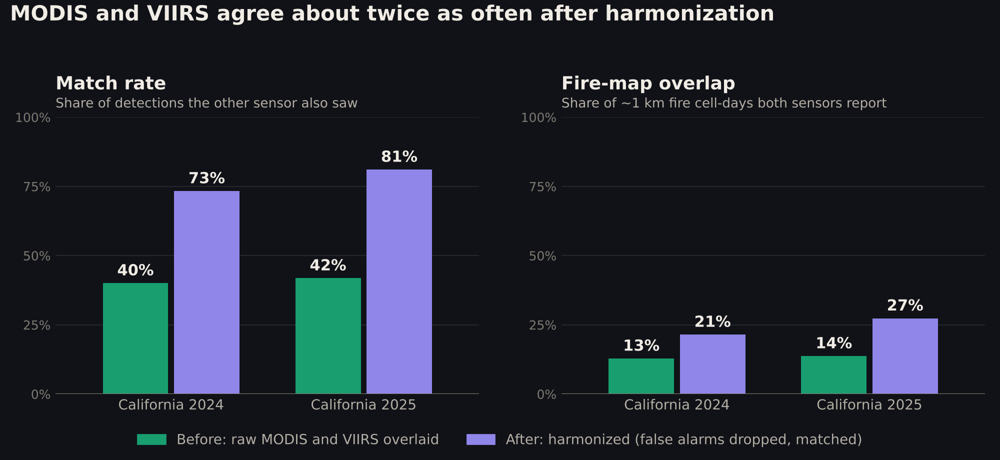
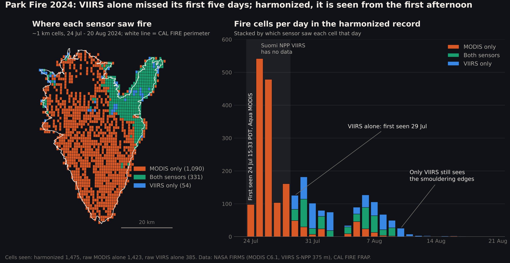
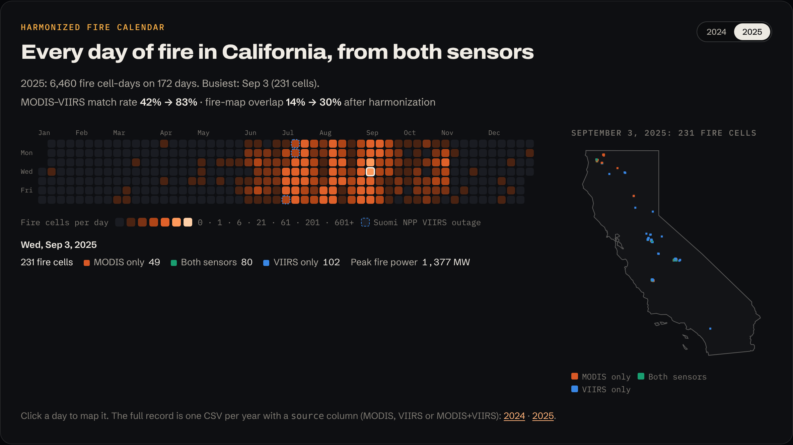
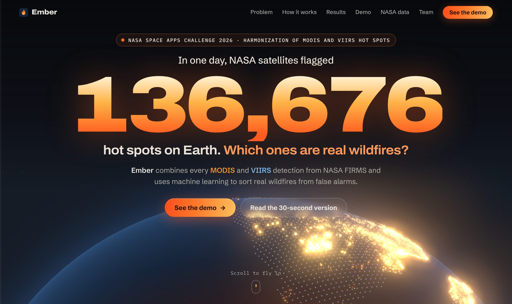

# Ember: one fire record from MODIS and VIIRS

**Live site: <https://emberwildfires.vercel.app>** · NASA Space Apps Challenge 2026, *Harmonization of MODIS and VIIRS Hot Spots* (solo entry)

Ember merges every MODIS and VIIRS hot spot over California into **one daily harmonized fire record**. A Random Forest
drops false alarms, matching detections are paired across the two sensors, and every ~1 km fire cell gets a `source`
column: `MODIS`, `VIIRS` or `MODIS+VIIRS`.

## Results

Neither year below was used to train or tune anything.

| California | MODIS–VIIRS match rate | Fire-map overlap (cell-days both report) | Detections inside a CAL FIRE perimeter |
|---|---|---|---|
| 2024, raw | 40.1 % | 12.8 % | 61.9 % |
| **2024, harmonized** | **76.1 %** | **23.6 %** | **95.5 %** |
| 2025, raw | 41.8 % | 13.7 % | 56.3 % |
| **2025, harmonized** | **82.9 %** | **29.8 %** | **93.2 %** |



**Case study, Park Fire 2024 (429,603 acres):**
- Suomi NPP VIIRS has no California data from 24 to 28 July, the fire's first five days, so VIIRS alone first sees it on 29 July.
- The harmonized record has it from Aqua MODIS at **15:33 PDT on 24 July**. In the first week it marks **1,201** burning cells; raw VIIRS alone marks 170.
- VIIRS then keeps the smouldering edges after MODIS loses them.



**Harmonized fire calendar** on the live site: every day of 2024 and 2025. Click a day to map its fire cells by sensor.



**Known weak spots**
- **Winter fires are dropped.** The classifier rejects every detection of January 2025's Palisades, Eaton and Hughes
  fires, and of five more. It was trained on 2020, which had almost no large January fires.
- **Small fires are missed.** Of 394 fires under 100 acres in 2024, the harmonized record sees 70.
- **Part of the agreement gain is built in.** The classifier uses cross-sensor confirmation as an input, so the CAL FIRE
  perimeter check is the independent evidence.
- **Outages and timing.** On VIIRS outage days the record is MODIS alone, and no satellite passes between about 14:00 and 22:30 local time.

Full method, all numbers and the sensitivity analysis: [`ml/README.md`](ml/README.md) and
[`ml/outputs/harmonized/results.json`](ml/outputs/harmonized/results.json).
Records: [`harmonized_fires_2024.csv`](ml/outputs/harmonized/harmonized_fires_2024.csv),
[`harmonized_fires_2025.csv`](ml/outputs/harmonized/harmonized_fires_2025.csv).

### Reproduce (no API key needed, about 3 minutes)

Needs [uv](https://docs.astral.sh/uv/). Downloads come from NASA FIRMS archive files, CAL FIRE and the US Census.

```bash
uv run --project ml python ml/fetch_data.py 2024 2025
```
```bash
uv run --project ml python ml/harmonize.py 2024 2025
```
```bash
uv run --project ml python ml/validate.py 2024 2025
```
```bash
uv run --project ml python ml/plot_validation.py
```
```bash
uv run --project ml python ml/case_study.py
```
```bash
uv run --project ml python ml/export_site_data.py 2024 2025
```



---

# The Ember app

A macOS app that downloads NASA FIRMS satellite fire detections from **MODIS** and **VIIRS**
and shows each one on a map exactly as reported, with no clustering, merging, or filtering.

## 1. Add your MAP_KEY

1. Request a free key at <https://firms.modaps.eosdis.nasa.gov/api/map_key/> (it's emailed to you).
2. Open `MyApp/Secrets.plist` and replace `PASTE_YOUR_MAP_KEY_HERE` with your key.
   (If that file is missing, copy `Secrets.example.plist` from the project root to `MyApp/Secrets.plist`.)
3. Build and run in Xcode.

`MyApp/Secrets.plist` is listed in `.gitignore`, so your key never ends up in git.
Settings (⌘,) shows whether the key was found.

## 2. Use it

| Action | Shortcut |
|---|---|
| Refresh | ⌘R |
| Fetch with the current sidebar settings | ⌘↩ |
| Cancel download | ⌘. |
| Export combined CSV | ⌘E |
| Show/hide MODIS, VIIRS | ⌘1, ⌘2 |
| Harmonized ML filter (wildfires only) | ⌘3 |
| Zoom to area | ⌘0 |
| Show/hide inspector | ⌥⌘I |
| Step through overlapping detections | [ and ] |
| Clear selection | Esc |

The **Show** picker at the top of the sidebar switches between MODIS only, VIIRS only, both
(raw), and **ML**. ML mode shows both sensors and hides detections that a random forest trained on
harmonized MODIS + VIIRS data judges are not wildfire: farm and prescribed burns, industrial heat,
and false alarms. On California 2021 it removed 92% of non-wildfire detections at 99% precision, and caught
126 of 168 mapped fires, including 49 of 77 fires with fewer than 5 detections. On 2022 and
2023, which it never saw, accuracy was 93% and 90%; guessing "wildfire" every time gets 45%. It
keeps working if MODIS or VIIRS goes offline. A
**Sensitivity** slider trades catching more small fires against removing more false alarms. The inspector shows each detection's wildfire probability. The filter changes
only the map; the cache and CSV export are unchanged. See `ml/README.md` for how the model was built.

Click any point to see every FIRMS column for it. If several detections overlap under the
cursor, the inspector lists all of them, one at a time.

## 3. Load the export in Python

```python
import pandas as pd
df = pd.read_csv("firms_California_2026-11-06_to_2026-11-07.csv", parse_dates=["acq_datetime_utc"])
modis = df[df.sensor == "MODIS"]   # use confidence_percent (0–100)
viirs = df[df.sensor == "VIIRS"]   # use confidence_category (low / nominal / high)
```

## FIRMS API facts used (checked Nov 2026)

- Endpoint: `/api/area/csv/[MAP_KEY]/[SOURCE]/[west,south,east,north]/[DAY_RANGE]/[DATE]`
- `DAY_RANGE` is 1–5. Longer ranges (up to 10 days in Ember) are split into several requests.
- Sources: `MODIS_NRT`, `MODIS_SP`, `VIIRS_SNPP_NRT/SP`, `VIIRS_NOAA20_NRT/SP`, `VIIRS_NOAA21_NRT/SP`
- Limit: 5,000 transactions per 10 minutes per key. Ember limits itself to 250 and waits 15 s between refreshes.
- **Suomi NPP stopped producing new FIRMS data on Nov 2, 2026.** That's why the VIIRS satellite
  defaults to NOAA-20, which has the same 375 m VIIRS instrument. Choose Suomi NPP in the sidebar
  to get its archive data from before that date.

## Code map

```
MyApp/
  Models/      FireDetection, FireQuery (area, dates, source names)
  Networking/  FIRMSClient (download), FIRMSError, RateLimiter
  Parsing/     CSVParser (generic), FIRMSParser (CSV → FireDetection)
  Processing/  DetectionProcessor ← add your future processing step here
  Storage/     DetectionCache (offline copy)
  Export/      CSVExporter
  Store/       FireStore (app state: download → parse → process → map)
  Map/         MapKit view + fast single-overlay renderer
  UI/          Sidebar, inspector, HUD panels, menus, menu bar item, Settings
```
