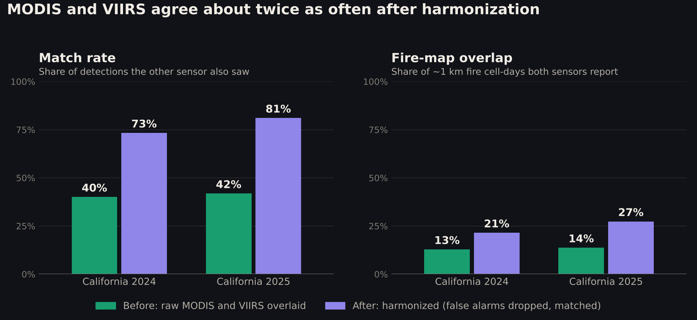
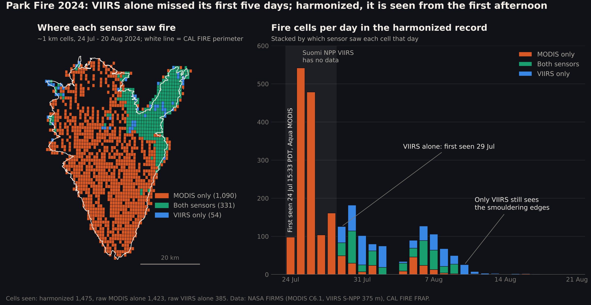

# Harmonized MODIS + VIIRS wildfire classifier

A random forest that classifies each satellite fire detection as part of a mapped wildfire or not (farm
and prescribed burns, industrial heat sources, false alarms). The app ships **v4**, trained on California
2020–2023 across all months and tested on 2024 and 2025 (see "v4: the year-round model"). The sections
from here to v3 describe how the earlier models were built on 2020 and tested on 2021.

```
uv run --project ml python ml/train_rf.py     # ~90 s; writes ml/outputs/results.json
```

## Data (`ml/data/raw/`, not committed; `fetch_data.py` downloads it)
- **NASA FIRMS standard archive:** MODIS C6.1 (`data/country/modis/{YEAR}/modis_{YEAR}_United_States.csv`)
  and VIIRS S-NPP 375 m (`data/country/viirs-snpp/...`). No key needed. Detections are clipped to
  California using the Census `cb_2020_us_state_500k` boundary.
- **Labels:** CAL FIRE FRAP perimeters (`California_Historic_Fire_Perimeters/FeatureServer/0`). A
  detection is labeled wildfire if it falls inside a perimeter between 1 day before the alarm date
  and 2 days after containment. Fires with no containment date get a 120-day window.

## Harmonization
- **One schema for both sensors:** mid-IR brightness (MODIS `brightness` / VIIRS `bright_ti4`),
  thermal-IR brightness (`bright_t31` / `bright_ti5`), and their difference ΔT.
- **Resolution-independent FRP:** FRP per km² of pixel area. MODIS pixels are 1 km, VIIRS 375 m.
- **One confidence scale:** MODIS 0–100 % is binned to low/nominal/high (<30 / 30–79 / ≥80) to match
  VIIRS l/n/h.
- **Cross-sensor features:** whether the other satellite saw fire within 2 km and ±1 day, plus
  combined cluster size, 3-day persistence and recurrence at persistent industrial sites.

## Results: test on 2021 (247,389 detections, 131 mapped fires)

| Model | Accuracy | Recall | Precision | ROC-AUC |
|---|---|---|---|---|
| **Combined MODIS+VIIRS RF** | **0.938** | **0.991** | **0.940** | **0.914** |
| MODIS-only RF (MODIS test rows) | 0.899 | 0.987 | 0.900 | 0.862 |
| Combined RF on MODIS test rows | 0.902 | 0.981 | 0.906 | 0.891 |
| VIIRS-only RF (VIIRS test rows) | 0.945 | 0.992 | 0.947 | 0.908 |
| Baseline: always guess "wildfire" | 0.856 | 1.000 | 0.856 | 0.5 |
| Baseline: FIRMS confidence ≥ nominal | 0.821 | 0.952 | 0.855 | n/a |

- Specificity is 0.62: the model correctly rejects 62 % of non-wildfire detections. Balanced
  accuracy is 0.81.
- **Fire-level recall** counts a fire as caught if at least one of its detections is flagged:
  - Fires with 100 or more detections: 24 of 24.
  - Fires with 20–99 detections: 10 of 12.
  - Fires with 5–19 detections: 7 of 26.
  - Fires with 1–4 detections: 2 of 69.
- The context features are the strongest signals: cluster size, cross-sensor confirmation and
  persistence.

## v4: the year-round model (`train_v4.py`), shipped in the app

```
uv run --project ml python ml/fetch_data.py 2020 2021 2022 2023
uv run --project ml python ml/train_v4.py      # ~25 min on 4 cores; writes MyApp/ML/ember_rf.bin
```

**Why.** v3 learned the calendar instead of the fire. On mapped California fires it kept 93–99 % of detections from
June to October, but 0 % of the January 2025 LA fires (Palisades, Eaton, Hughes), 1 % in November 2025, and 1 of 12
wildfires burning in the US during the live test week. With `month` forced to August, the same live detections passed,
prescribed burns included.

**What changed** (same 29 features, same file format, so the app's Swift code only changes the default cutoff):
- Training data: California **2020, 2021, 2022 and 2023, every month** (v3: 2020 only). 1.23 M rows with the
  single-sensor copies; 134 off-season fires.
- `month` is held constant during training, so no tree splits on it (its importance is exactly 0). The app still
  passes the month, and it has no effect.
- **Month-balanced weights:** within each month, wildfire and non-wildfire detections get the same total weight, on top
  of v3's 1 / (fire size) weighting, so winter fires aren't drowned out by winter farm burns.
- Weighting strength and cutoff were chosen by **leave-one-year-out CV over 2020–2023** (`outputs/v4_cv.csv`), scoring
  in-season (Jun–Oct) and off-season (Nov–May) equally. Chosen: full balancing, cutoff **0.30**. Held-out-year CV: fire
  recall 0.95 in season and 0.89 off season, with 74 % and 90 % of non-wildfire detections removed.
- **2024 and 2025 were never used for training or selection.** They are the test years. Caveat: the decision to
  retrain came from seeing v3 fail on them.

| Never-seen test year | v3 (cutoff 0.60) | **v4 (cutoff 0.30)** | v4 at 0.60 |
|---|---|---|---|
| 2024 fires caught | 161 / 205 | **186 / 205** | 168 / 205 |
| 2024 off-season fires (Nov–May) | 11 / 43 | **33 / 43** | |
| 2024 in season: recall · precision | 0.964 · 0.956 | **0.992** · 0.953 | |
| 2024 non-wildfire removed (all year) | 92.8 % | 85.7 % | 94.4 % |
| 2025 fires caught | 128 / 185 | **168 / 185** | 149 / 185 |
| 2025 off-season fires | 7 / 50 | **42 / 50** | |
| 2025 in season: recall · precision | 0.933 · 0.934 | **0.992** · **0.941** | |
| 2025 non-wildfire removed (all year) | 92.3 % | 85.0 % | 94.6 % |
| Palisades · Eaton · Hughes detections kept | 0 % · 0 % · 0 % | **100 % · 99 % · 89 %** | |
| Mountain Fire (Nov 2024) detections kept | 59 % | **91 %** | |

- **In season, nothing got meaningfully worse:** precision moved 0.956 → 0.953 (2024) and 0.934 → 0.941 (2025), and recall went up.
- **Off season, more false alarms get through:** only 50 % (2024) and 64 % (2025) of the off-season detections v4 keeps
  are inside a mapped fire. Winter farm burns and fires are harder to tell apart.
- **At v3's old 0.60 cutoff, v4 beats v3 on every metric in both years** (more fires, more false alarms removed, higher
  precision). The app's Sensitivity slider (0.20–0.80) moves along this trade-off; 0.30 stays the default because it
  was chosen without looking at the test years.
- Top features: burn history 0.29, agricultural land 0.12, peak FRP within 5 km 0.08, shrub 0.08, thermal-IR
  brightness 0.06. `month` 0.
- Swift parity: the regenerated `outputs/swift_golden.csv` (18,943 detections, 14–17 Aug 2021) matches the Python
  pipeline to 7e-9 with no decision changes. Run `sh ml/swift_tests/run.sh` on a Mac to check the Swift side.
- The stress test and v3 sections below describe v3. 2022 and 2023 are now training years, so the stress test's
  "never seen" rows no longer apply to v4.

## Harmonized daily fire record (`harmonize.py`)

```
uv run --project ml python ml/fetch_data.py 2024 2025     # FIRMS archive + CAL FIRE + CA boundary, no key
uv run --project ml python ml/harmonize.py 2024 2025      # ~30 s
```

1. **Load** MODIS (Terra + Aqua, 1 km) and VIIRS (Suomi NPP, 375 m) for California on the shared schema above.
2. **Drop false alarms** with the shipped model (v4: `MyApp/ML/ember_rf.bin` + `ember_static.bin`, cutoff from
   `outputs/swift_threshold.txt`), run exactly as the app runs it. On the 18,943-row Swift golden file this path
   reproduces the model's probabilities to 7e-9 with no decision changes.
3. **Match across sensors.** A MODIS and a VIIRS detection are the same fire if:
   - **distance:** their pixel footprints touch (centers within the sum of the two half-diagonals, 1–5 km).
     MODIS pixels grow from 1 km at nadir to about 2 × 4.8 km at the scan edge, so a fixed radius fails at one end.
   - **time:** they were seen within 6 hours of each other. That pairs Terra 10:30 with Aqua and S-NPP 13:30,
     but never a day pass with a night pass.
   - **confidence:** at least one of the two is nominal or high. Two low-confidence detections don't confirm each other.
4. **Daily record:** one row per 0.01° cell (~1 km, the grid of the classifier's static features) per Pacific-time day.

`outputs/harmonized/harmonized_fires_{YEAR}.csv` columns:

| Column | Meaning |
|---|---|
| `date` | Pacific-time date |
| `cell_id`, `lat`, `lon` | 0.01° cell and the mean position of its detections |
| `source` | `MODIS`, `VIIRS` or `MODIS+VIIRS`: which sensors saw fire in this cell that day |
| `cross_confirmed` | a detection here matched the other sensor (distance + time + confidence) |
| `confidence` | `high` if cross-confirmed or either sensor said high, else the best single-sensor class |
| `n_modis`, `n_viirs`, `satellites` | detections per sensor, and which satellites (Terra, Aqua, Suomi NPP) |
| `frp_max_modis`, `frp_max_viirs` | peak fire radiative power per sensor, MW |
| `wildfire_prob` | highest classifier probability in the cell |
| `daynight`, `first_utc`, `last_utc` | day/night passes, first and last observation |

## Validation (`validate.py`, `plot_validation.py`)

```
uv run --project ml python ml/validate.py 2024 2025     # writes outputs/harmonized/results.json
uv run --project ml python ml/plot_validation.py        # writes outputs/harmonized/agreement.png
```



**Before** = raw FIRMS overlaid: every detection, compared on the same ~1 km cell and UTC day.
**After** = the harmonized record (v4 classifier): false alarms dropped, then matched by footprint distance, a 6 h
window and confidence. Neither year was used to train or tune the classifier.

| California | Match rate before → after | Fire-map overlap (cell-days both sensors report) before → after |
|---|---|---|
| 2024 | 40.1 % → **73.3 %** | 12.8 % → **21.5 %** |
| 2025 | 41.8 % → **81.1 %** | 13.7 % → **27.3 %** |

How each part contributes (2024): the matching rules alone take the match rate from 40 % to 57 %.
Dropping false alarms takes it to 73 %. The time window matters most: ±1 h gives 36 %, ±6 h 73 %, ±12 h 79 %.
The confidence rule changes almost nothing (73.4 % vs 73.3 %), because the classifier has already removed most
low-confidence detections.

Checked against CAL FIRE perimeters:

| | 2024 | 2025 |
|---|---|---|
| Raw detections inside a mapped fire | 61.9 % | 56.3 % |
| Harmonized detections inside a mapped fire | **91.8 %** | **89.5 %** |
| Mapped-fire detections the classifier keeps | 98.9 % | 98.9 % |
| Fires ≥ 1,000 acres seen: raw MODIS / raw VIIRS / harmonized | 50 / 43 / **50** of 55 | 31 / 32 / **33** of 35 |
| Fires < 100 acres seen: raw MODIS / raw VIIRS / harmonized | 54 / 73 / **84** of 394 | 40 / 89 / 88 of 408 |

With v3 the record was cleaner (95.5 % and 93.2 % inside mapped fires) but lost 8 large 2025 fires, all of them in
January, including Palisades and Eaton. With v4 it loses none: every large fire that either sensor saw is in the record.

### Known weak spots
- **Off-season false alarms.** v4 keeps winter fires, but about half of what it keeps from November to May is not a
  mapped fire (winter farm and prescribed burns). In the record those cells look like real fires.
- **Small fires are missed.** Of the 2024 fires under 100 acres, raw MODIS saw 54 of 394, raw VIIRS 73 and the
  harmonized record 84. Most small fires are below what either sensor resolves.
- **Part of the gain is built in.** One of the classifier's features is "the other sensor saw fire within 2 km
  yesterday or today", so filtering favors detections the other sensor confirms. The perimeter checks above are
  the independent evidence that the filtered record is cleaner, not just more self-consistent.
- **Sensor outages.** Suomi NPP VIIRS has no California detections on 2024-05-30 to 06-03, 07-10 to 07-15 and
  07-24 to 07-28 (the Park Fire's first five days). On those days the record falls back to MODIS alone.
- **No afternoon pass.** All four satellites pass around 10:30, 13:30, 22:30 and 01:30 local time, so a fire that
  starts after about 14:00 is first seen at night.
- **Only Suomi NPP VIIRS.** NOAA-20 and NOAA-21 have no yearly FIRMS files; adding them needs a FIRMS key
  (`fetch_data.py --noaa20`) and would add two more passes a day.
- The daily-count correlation (in `results.json`) is not a reliable third metric: in 2024 it is 0.32 before and
  0.37 after, because VIIRS outage days dominate it.

## Case study: Park Fire 2024 (`case_study.py`)

```
uv run --project ml python ml/case_study.py     # park_fire.png, park_fire.json, park_fire_cells.geojson
```



The Park Fire (Butte and Tehama counties, 429,603 acres, California's 4th largest) started on 24 July 2024.

- **Suomi NPP VIIRS has no California data from 24 to 28 July**, the fire's five fastest days. Raw VIIRS
  alone first sees it at 13:03 PDT on 29 July. Aqua MODIS saw it at **15:33 PDT on 24 July**, so the harmonized
  record starts on the first afternoon.
- In the first week (24–30 July) raw VIIRS alone marks 170 ~1 km cells as burning. The harmonized record marks **1,270**.
- Across the fire, the harmonized record marks 1,475 cells: 1,090 that VIIRS alone never saw, and 54 that MODIS alone never saw.
- On 10, 12, 15 and 17 August only VIIRS still detects the smouldering edges; MODIS's 1 km pixels see nothing.
- Fire days covered: raw MODIS 19, raw VIIRS 18, harmonized **23**.

## Live test, 6–13 Nov 2026 (`live_test.py`)

```
uv run --project ml python ml/live_test.py     # last 7 days of FIRMS NRT + NIFC current incidents, no key
```

The shipped model scored the last 7 days of near-real-time FIRMS detections for the contiguous US:
11,297 detections from MODIS and NOAA-20 VIIRS, the app's pair. The answer key is NIFC's WFIGS current incidents:
136 wildfires (WF) and 176 prescribed burns (RX), plus 42 mapped perimeters. Results for v3 are kept in
`outputs/live/live_test_v3.json`.

| Detections | Count | Kept by v3 (0.60) | Kept by **v4** (0.30) |
|---|---|---|---|
| At a current wildfire | 111 | 4.5 % | **81 %** |
| At a current prescribed burn | 190 | 0 % | 42 % |
| Near no reported incident | 10,996 | 0.3 % | 35 % |

- **Wildfires:** FIRMS saw 12 current wildfires this week. v3 caught 1 (Mud, Idaho). **v4 catches 7**, including all
  three seen in the last 24 hours: Mud (ID, 1,000 acres), Red Hill (MS, 519) and a small fire in California. It still
  misses Hunts Fork (VA, 313 acres), Campbell–Glassman Way (TN, 380) and three others; most had a single detection.
- **Why v3 failed:** it learned the season. In the archive it kept 1 % of mapped-fire detections in November 2025 and
  0 % in January 2025. Rescored with `month` set to August, the same live detections passed, prescribed burns included.
- **v4's cost:** it also keeps 20 of 36 prescribed burns and about a third of detections near no reported incident.
  Outside California the land-cover and burn-history inputs (v4's strongest) are blank, so it has less to go on.
  Inside California it keeps 30 % of unreported detections.

**Conclusion:** v4 now finds most fires burning right now, but outside California and outside fire season it raises
many false alarms. Next steps: prescribed burns as explicit negatives (WFIGS tags them), and land-cover and
burn-history grids beyond California.

## Small fires (v2): `small_fires.py`

The first model caught every big fire but almost none of the small ones (0 of 69 fires with fewer
than 5 detections). There were two causes:

1. **Label noise.** A pixel's center can sit just outside a fire's drawn perimeter even when the
   pixel overlaps the fire. With one pixel of tolerance (375 m for VIIRS, 1 km for MODIS),
   13,407 of the 35,669 2021 "non-wildfire" detections turned out to be edge pixels of big
   fires like Dixie and Caldor. These have a median of 89 neighboring detections; the remaining
   negatives have a median of 2.
2. **Big fires dominated training.** Each wildfire detection is now weighted by 1 / (number of
   detections in its fire), so every fire counts equally.

The weighting and the 0.5 cutoff were chosen using only 2020 data, with cross-validation grouped
by month. 2021 was not used to pick them.

| 2021 test, app features | Fires caught (all) | 1–4 detections | 5–19 | 20–99 | 100+ | Non-wildfire removed | Recall | Precision |
|---|---|---|---|---|---|---|---|---|
| v1 (exact perimeters) | 36/131 | 0/69 | 3/26 | 9/12 | 24/24 | 68.5 % | 0.962 | 0.948 |
| **v2 (1-pixel tolerance + fire weighting)** | **107/168** | **31/77** | **34/46** | **16/19** | **26/26** | **90.1 %** | **0.981** | **0.990** |

Scored against the old exact-perimeter labels, v2 still catches 93 of 131 fires (37 of 69 small
ones), but removes only 58.6 % of "non-wildfire" detections, because those labels count
fire-edge pixels as non-wildfire.

## v3 (`build_static_grids.py`, `train_v3.py`), shipped before v4

New inputs:
- **Land cover:** fractions of forest, shrub, grass, agriculture and developed land in each
  ~1 km cell, from USGS NLCD 2019.
- **Burn history:** the number of months in 2017–2019 with any fire detection within ~1 km.
  Refineries and farm fields light up again and again; the Richmond refinery scores 36 of 36
  months, the 2018 Camp Fire area scores 1. Both years predate training and test, so nothing leaks.
- **Day/night persistence:** night and day detections within 5 km over today and yesterday,
  plus yesterday's activity. Wildfires burn through the night; farm burns are short daytime fires.
- **Total FRP within 5 km.**
- **Is the other satellite reporting today?** The training data also includes VIIRS-only and
  MODIS-only copies of 2020 (at half weight), so the model keeps working if a satellite goes
  offline. Before this fix, the stress test showed recall falling to 75 % with VIIRS alone.

Every context feature now looks only at the same UTC day or the day before. v1/v2 also looked
one day ahead, which the live app can't do for today's detections. The app downloads one extra
day of context before the requested range.

Hyperparameters, fire weighting and the cutoff were chosen by 4-fold cross-validation on 2020,
grouped by month (`outputs/v3_cv_2020.csv`). The chosen settings: 100 trees, depth 14, 30-sample
leaves, max_features 0.4, weights 1/(fire size), cutoff 0.60. The static features were blanked
for 10 % of training rows, so the model still works outside California.

| 2021 test (perimeters + 1 pixel) | Recall | Precision | Non-wildfire removed | Fires caught | 1–4 det. | 5–19 | 20–99 | 100+ |
|---|---|---|---|---|---|---|---|---|
| Always guess "wildfire" | 1.000 | 0.910 | 0 % | 168/168 | 77/77 | 46/46 | 19/19 | 26/26 |
| FIRMS confidence ≥ nominal | 0.953 | 0.910 | 4.3 % | 166/168 | | | | |
| v2 (cutoff 0.5) | 0.981 | 0.990 | 90.1 % | 107/168 | 31/77 | 34/46 | 16/19 | 26/26 |
| **v3, default cutoff 0.60** | 0.971 | **0.992** | **92.4 %** | **126/168** | **49/77** | 35/46 | 16/19 | 26/26 |
| v3, cutoff 0.50 | 0.985 | 0.991 | 91.1 % | 131/168 | 53/77 | 36/46 | 16/19 | 26/26 |
| v3, cutoff 0.40 | 0.994 | 0.990 | 89.5 % | 136/168 | 56/77 | 38/46 | 16/19 | 26/26 |
| v3 with no land cover or history (outside CA) | 0.959 | 0.989 | 89.3 % | 104/168 | 28/77 | 35/46 | 16/19 | 25/26 |

The 0.40 and 0.50 rows are a sensitivity analysis: they were measured on 2021, so they were not
used to pick the default. The app's Sensitivity slider moves along this trade-off.

The most important features are burn history (0.31), month (0.18), agricultural land (0.10),
shrub (0.07), and peak FRP within 5 km (0.05).

The Swift parity test on 18,943 detections (14–17 Aug 2021) passes: all 29 features match,
including the land-cover and history lookups; probabilities differ by at most 5e-7; and no
decision changes.

## Stress test (`stress_test.py`, `swift_tests/`)

Every row below is scored with the exported forest, exactly as the app runs it, at the 0.60
default. "Always fire" is the accuracy of guessing "wildfire" every time.

| Scenario | Accuracy (always fire) | Recall | Precision | Non-wildfire removed | AUC | Fires caught |
|---|---|---|---|---|---|---|
| 2021, the test year | 0.966 (0.910) | 0.971 | 0.992 | 92.4 % | 0.977 | 126/168 |
| **2022, never seen, quiet year** | **0.928 (0.446)** | 0.908 | 0.930 | 94.5 % | 0.975 | 86/114 |
| **2023, never seen, quiet year** | **0.903 (0.449)** | 0.945 | 0.855 | 86.9 % | 0.935 | 97/116 |
| 2023 with NOAA-20 VIIRS (the app's satellite) | 0.907 (0.449) | 0.947 | 0.860 | 87.5 % | 0.940 | 88/114 |
| 2021, VIIRS only (MODIS gone) | 0.963 (0.911) | 0.967 | 0.992 | 92.2 % | 0.970 | 120/161 |
| 2021, MODIS only (VIIRS gone) | 0.908 (0.908) | 0.906 | 0.992 | 92.7 % | 0.960 | 82/108 |
| 2023, VIIRS only | 0.912 (0.453) | 0.951 | 0.866 | 87.9 % | 0.939 | 90/110 |
| 2023, no land cover or history | 0.861 (0.449) | 0.956 | 0.783 | 78.3 % | 0.937 | 81/116 |
| 2021, ±15 % FRP, ±2 % brightness, 500 m position jitter | 0.965 (0.910) | 0.969 | 0.992 | 92.3 % | 0.976 | 123/168 |
| 2023, scored in the app's 3-day downloads | identical to scoring the whole year at once (100 % of decisions) | | | | | |

The Swift edge-case suite covers:
- empty input, every field missing, no timestamp, impossible coordinates;
- poles and the dateline, and points outside the static grid;
- infinite and negative values;
- 500 duplicate points, and scores that don't depend on input order;
- a VIIRS-only fire cluster;
- corrupt and truncated model files.

All cases pass. Scoring speed on an M5 Pro:

| Load | Time |
|---|---|
| 20k detections | 0.1 s |
| 200k detections | 2.4 s |
| Busiest real 3 days (8–10 Sep 2020, 41,750 detections) | 1.0 s |
| Synthetic worst case (30,000 detections inside 20 km) | 7.2 s |

Scoring runs off the main thread.

```
uv run --project ml python ml/fetch_data.py 2022 2023
FIRMS_MAP_KEY=... uv run --project ml python ml/fetch_data.py --noaa20 2023
uv run --project ml python ml/stress_test.py
sh ml/swift_tests/run.sh
```

```
uv run --project ml python ml/build_static_grids.py   # NLCD + FIRMS 2017-2019 -> grids + MyApp/ML/ember_static.bin
uv run --project ml python ml/train_v3.py             # tune on 2020, test on 2021 -> MyApp/ML/ember_rf.bin
```

## Earlier app model (v2)

`export_app_model.py` trains the compact version that ships in the app as `MyApp/ML/ember_rf.bin`
(3.0 MB): the v2 model, 100 trees, max depth 14. It drops the 3-day and 1-year history features,
because the app downloads only 1–10 days at a time.

| 2021 test | Accuracy | Recall | Precision | AUC | Non-wildfire removed | Shown that are non-wildfire |
|---|---|---|---|---|---|---|
| App model (v2) | 0.974 | 0.981 | 0.990 | 0.987 | 90.1 % | 1.0 % |

`MyApp/ML/WildfireClassifier.swift` reimplements the features and the tree walk. It was checked
against Python on 17,425 detections from 15–17 Aug 2021: every feature matches, probabilities
differ by at most 5e-7, and no wildfire/not-wildfire decision changes. The script writes the
reference file to `ml/outputs/swift_golden.csv`.

```
uv run --project ml python ml/export_app_model.py
```
